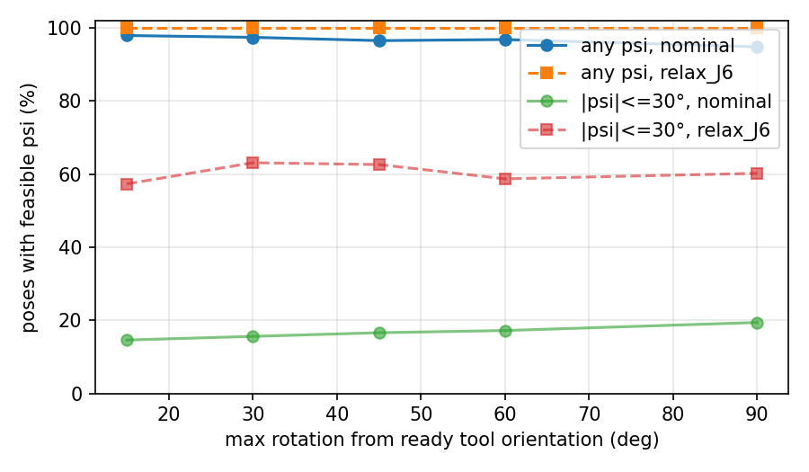

# 02. NERO 기구학 검증 (시뮬레이션)

> 작성일 2026-11-03 · 상태: **초안** · Roadmap Phase 1 (1.1–1.4)
> 코드: [../sim/](../sim/) · 실기 검증은 아직 없음 (전부 URDF 기반 계산)

## 1. 요약

- NERO 공식 URDF는 **SRS 구조가 맞다** (J1–J3 축이 한 점, J5–J7 축이 한 점에서 만남, 수치 검사 1e-6 m 이내). |SE| = 0.310 m, |EW| = 0.270 m 재확인.
- SEW 각 ψ로 매개화한 **해석적 IK**를 구현했다 (자세 + ψ → 최대 8개 해). 무작위 관절각 1000개에서 FK → IK가 원래 관절각을 모두 되찾았다.
- **J4 한계 때문에 |W − S| ≥ 0.281 m**: 팔을 그 이상 접을 수 없다 (손목 중심이 어깨에서 28 cm 안으로 못 들어옴).
- **ready 자세(손바닥 아래)에서 팔꿈치 아래 ψ ∈ (−70°, +70°)는 불가능**하고, 원인은 J6다.
- 손목 자세 자체는 ready 근처에서 95–98% 가능하다 (불가능한 경우의 원인은 J6). 그러나 **팔꿈치 아래(|ψ| ≤ 30°)가 가능한 자세는 15–19%뿐**이고, 주로 J6와 J2가 막는다 (§5).

이 결과는 연구 질문에 직접 걸린다: 사람의 팔꿈치 각을 그대로 따라가는 방식(SEW-Mimic류)은 NERO에서 자주 실행 불가능하다. → 01 문서의 G2(관절 한계) 근거, Feasible-MAP의 필요성 근거. 단, **사람 손목 방향 분포를 측정한 것은 아니다** (§6).

## 2. 모델 (1.1)

- URDF: `agilexrobotics/agx_arm_urdf` @ `680fa92` 의 `nero_description.urdf` (MIT), `share/sim/assets/`에 사본.
- 관절 축과 축 위의 점을 q = 0 에서 읽어 product-of-exponentials로 표현. DH 파라미터를 손으로 유도하지 않았다.
- 검증: URDF 원점·축 회전을 순서대로 곱한 독립 FK와 200개 무작위 관절각에서 1e-10 이내 일치.

| 관절 | 하한 (rad) | 상한 (rad) | 비고 |
|---|---|---|---|
| J1 | −2.705 | 2.705 | |
| J2 | −1.74 | 1.74 | |
| J3 | −2.75 | 2.75 | |
| J4 | −1.01 | 2.14 | 0 = 팔 완전히 폄 (특이) |
| J5 | −2.75 | 2.75 | |
| J6 | **−0.733** | **0.873** | 손목, 범위 약 92° |
| J7 | −1.571 | 1.571 | |

## 3. 해석적 IK (1.2)

입력: link7 자세 T, ψ. Paden–Kahan subproblem으로 푼다.

1. 손목 중심 W = T·M⁻¹·W₀ (J5–J7 축이 W₀를 지나므로 손목 관절과 무관)
2. θ₄: |W − S| 를 맞추는 subproblem 3 (해 2개)
3. ψ → 팔꿈치 E (S, W를 잇는 원 위의 점)
4. θ₁, θ₂: E₀ → E, subproblem 2 (해 2개)
5. θ₃: subproblem 1
6. θ₅, θ₆: subproblem 2 (해 2개) · θ₇: subproblem 1

검증 (무작위 관절각 1000개, 관절 한계 안에서 균일):
- 모든 해가 같은 자세와 같은 ψ를 재현 (FK 오차 최대 약 3e-7 m, 중앙값 약 5e-8 m — subproblem의 arccos/sqrt 반올림)
- **원래 관절각이 항상 8개 해 중 하나** (오차 < 1e-4 rad) → 해 열거가 완전하다. 이게 1.3의 "구간 밖은 불가능" 판정의 근거.

## 4. ψ feasible 구간 (1.3)

ψ 격자(기본 360개)에서 해 8개 중 하나라도 관절 한계 안이면 가능으로 보고, 경계는 이분법으로 1e-4 rad까지 좁힌다. 격자 간격보다 좁은 구간은 놓칠 수 있다.

검증: 무작위 자세 15개 × ψ 100개에서 구간 안 → 한계 안 해가 존재, 구간 밖 → 8개 해 모두 한계 위반 (경계 1e-3 rad 이내는 제외).

**ready 자세 주변 예** (손목 중심 고정, 도구 방향만 베이스 축 기준으로 회전):

| 자세 | 가능한 ψ | 총 길이 |
|---|---|---|
| ready | 70.1° → 180° → −70.1° (팔꿈치 위 쪽) | 220° |
| + 20° (x축) | 40.0° → 180° → −95.9° | 224° |
| + 20° (y축) | 56.2° → 180° → −93.9° | 210° |
| + 20° (z축) | 69.2° → 180° → −70.9° | 220° |
| + 40° (x축) | 32.1° → 180° → −133.9° | 194° |
| + 40° (y축) | 35.3° → 180° → −115.0°, 그리고 −52.9° ~ −35.3° | 227° |
| + 40° (z축) | 103.6° → 180° → −71.4° | 185° |

ready에서 ψ = 0°, 30°, 60° 의 8개 해를 보면 J6만 위반하는 해가 있다 (ψ = 60°에서 J6 = −0.85 < −0.733). 즉 **손바닥을 아래로 둔 채 팔꿈치를 내리는 것을 J6가 막는다.**

## 5. 손목 자세 실행 가능 비율 (1.4)

스크립트: `share/sim/analysis_wrist_feasibility.py --n 1000 --grid 180 --seed 0` → `share/sim/results/`

- 손목 중심: 로봇 앞 상자(x −0.60 ~ −0.10, y ±0.40, z 0 ~ 0.70 m)에서 균일, |W − S| 0.301 ~ 0.560 m (J4가 허용하는 0.281 ~ 0.580 m 안쪽, 위치 도달 한계가 결과에 섞이지 않게 함).
- 방향: ready 도구 방향에서 최대 15° ~ 90° 회전 또는 SO(3) 균일. 행마다 1000개 자세, ψ 격자 2°.
- `relax_Jk` = 관절 k의 한계만 [−π, π]로 풀었을 때. 원인 관절을 가리기 위한 열.

**(a) 어떤 ψ로든 가능한 자세 비율 (%)**

| 방향 | nominal | J1 | J2 | J3 | J4 | J5 | **J6** | J7 | 한계 없음 | 가능한 ψ 중앙값 |
|---|---|---|---|---|---|---|---|---|---|---|
| ready ±15° | 97.9 | 97.9 | 98.5 | 97.9 | 98.5 | 98.5 | **100.0** | 98.5 | 100.0 | 180° |
| ready ±30° | 97.4 | 97.4 | 98.2 | 97.4 | 98.2 | 98.2 | **100.0** | 98.2 | 100.0 | 182° |
| ready ±45° | 96.5 | 96.5 | 97.8 | 96.5 | 97.8 | 97.8 | **100.0** | 98.1 | 100.0 | 180° |
| ready ±60° | 96.8 | 96.8 | 98.0 | 96.8 | 97.9 | 97.9 | **100.0** | 98.0 | 100.0 | 172° |
| ready ±90° | 94.8 | 94.8 | 95.5 | 94.8 | 95.3 | 95.3 | **100.0** | 97.5 | 100.0 | 160° |
| SO(3) 균일 | 73.2 | 73.2 | 76.1 | 73.2 | 74.2 | 74.2 | **100.0** | 97.5 | 100.0 | 118° |

**(b) 팔꿈치 아래(|ψ| ≤ 30°)로 가능한 자세 비율 (%)**

| 방향 | nominal | J1 | **J2** | J3 | J4 | J5 | **J6** | J7 | 한계 없음 |
|---|---|---|---|---|---|---|---|---|---|
| ready ±15° | **14.6** | 14.6 | 41.7 | 14.6 | 16.6 | 16.6 | 57.3 | 31.9 | 100.0 |
| ready ±30° | **15.6** | 15.7 | 39.2 | 15.7 | 17.7 | 17.7 | 63.1 | 35.8 | 100.0 |
| ready ±45° | **16.6** | 16.9 | 41.6 | 16.9 | 18.7 | 18.7 | 62.6 | 35.7 | 100.0 |
| ready ±60° | **17.2** | 18.1 | 42.7 | 18.1 | 20.4 | 19.6 | 58.7 | 36.2 | 100.0 |
| ready ±90° | **19.4** | 20.0 | 45.1 | 20.0 | 21.8 | 21.0 | 60.2 | 37.4 | 100.0 |
| SO(3) 균일 | **28.7** | 31.0 | 44.6 | 31.0 | 32.8 | 30.6 | 64.2 | 49.8 | 100.0 |

**해석**
1. **자세 자체는 대부분 가능하다.** ready 근처(±90° 이내)에서 95–98%. 불가능한 경우는 J6 하나만 풀면 전부 해결된다 → 자세 수준의 불가능 원인은 J6.
2. **그러나 ψ는 크게 제한된다.** 가능한 ψ가 원 둘레의 절반 정도(중앙값 160–182°)이고, **팔꿈치 아래(|ψ| ≤ 30°)가 가능한 자세는 ready 근처에서 15–19%뿐**이다.
3. 팔꿈치 아래를 막는 것은 **J6(풀면 57–63%)와 J2(풀면 39–45%)**이고, 한 관절만 풀어서는 100%가 되지 않는다 (여러 관절이 함께 막음).
4. 의미: 사람의 팔꿈치 각을 그대로 복사하면 대부분 실행 불가능한 ψ를 요구하게 된다 (사람이 앞에서 손바닥을 아래로 둘 때 팔꿈치는 보통 아래·옆이라는 가정 아래, **측정은 아님**). 사람 ψ → 로봇 ψ 매핑이나 feasible 구간으로의 투영이 반드시 필요하다는 근거.

## 6. 한계와 다음 단계

- **샘플링 분포는 가정이다.** 손목 위치는 로봇 앞 상자에서 균일, 방향은 ready 기준 원뿔 또는 SO(3) 균일. 텔레옵 중 사람 손목 방향 분포는 측정하지 않았다 → Track V 데이터로 다시 계산해야 한다.
- 원뿔 샘플은 회전각을 [0, cone]에서 균일하게 뽑았다 (측지 공에서 균일한 분포가 아님).
- 관절 한계만 봤다. 자기 충돌·속도 한계·특이점 근접은 아직 없음.
- 실기에서 URDF 한계와 실제 한계가 같은지 확인 필요 (roadmap 0.5).
- 다음: 1.5 시각화, Phase 2 oracle 실험 (ψ sweep, 팔 펴기, J6 한계 손목 장면).
